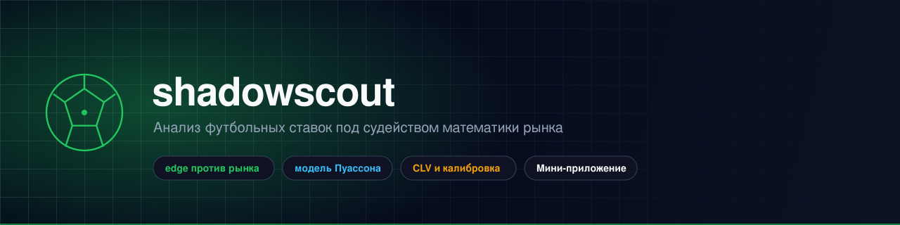
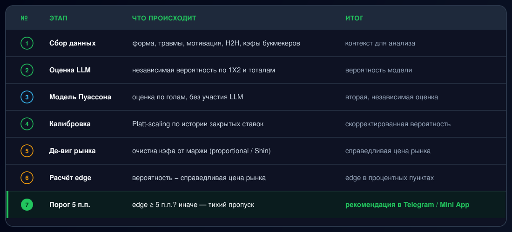

<p align="center">
  
</p>

<h1 align="center">shadowscout</h1>

<p align="center">
  Telegram-бот, который ищет в футбольных матчах реальный edge против рынка —<br/>
  и отдаёт вам Mini App-дашборд, где видно, на каких ставках он был прав, а на каких нет.
</p>

<p align="center">
  
  
  
  
  
</p>

---

shadowscout — не бот-типстер. Он не гонится за интуицией и никогда не ставит за вас.
Он собирает форму команд, травмы, мотивацию и историю личных встреч, просит LLM дать
собственную честную оценку вероятности, сверяет её с **независимой моделью Пуассона**
по голам и сравнивает результат с **очищенной от маржи (де-вигованной) справедливой
ценой рынка**. Рекомендация доходит до вас только тогда, когда модель обходит рынок
на реальную величину — во всех остальных случаях это молчаливый пропуск, и так
задумано.

Каждая рекомендация отслеживается до закрывающей линии и итогового результата, поэтому
собственные **CLV и калибровка** бота — а не просто винрейт — показывают, действительно
ли он находит edge или ему просто везёт.

## Содержание

- [Что умеет бот](#что-умеет-бот)
- [Как рождается рекомендация](#как-рождается-рекомендация)
- [Mini App](#mini-app)
- [Защитные механизмы](#защитные-механизмы)
- [Архитектура](#архитектура)
- [Быстрый старт](#быстрый-старт)
- [Конфигурация](#конфигурация)
- [Структура проекта](#структура-проекта)
- [Дисклеймер](#дисклеймер)

## Что умеет бот

| | |
|---|---|
| 🔎 **`/match Команда А - Команда Б`** | Полный разбор одного матча — форма, травмы, мотивация, рынки 1X2 и тоталы |
| 🏆 **`/league Ла Лига`** | Сканирует все ближайшие матчи лиги, показывает только те, где есть реальный edge |
| 📬 **`/digest Ла Лига, АПЛ`** | Тот же сканер, но автоматически каждую пятницу в 09:00 UTC |
| 💰 **`/bankroll 10000`** | Стейкинг флэт-процентом (по умолчанию 2%) со стоп-лоссом по просадке |
| ✅ **`/settle <id> win\|loss`** | Ручная фиксация исхода — бот и сам предложит подтвердить его после матча |
| 📊 **`/stats`** | Винрейт с доверительным интервалом Уилсона, ROI, CLV, Brier score, log-loss |

Шесть фоновых задач работают без запроса: захват закрывающей линии для CLV, проверка
движения линии в середине окна, предложение зафиксировать исход для ставленных пиков,
тихий авто-расчёт нетронутых пиков (чтобы статистика не была смещена в сторону только
тех ставок, которые вы выбрали сделать), проверка новостей перед стартом матча и
пятничный дайджест.

## Как рождается рекомендация

<p align="center">
  
</p>

Рынок должен подтверждаться минимум двумя букмекерами, прежде чем цене можно
доверять — единичная устаревшая котировка не сигнал. Как только накапливается
достаточно закрытых ставок, сырая вероятность от LLM пропускается через
Platt-калибровку перед проверкой edge, а не принимается на веру навсегда.

## Mini App

`/start` открывает постоянный дашборд прямо в Telegram (menu button + `WebAppInfo`),
чтобы рекомендации не терялись где-то на тридцать сообщений выше по чату:

- **Лента** — активные пики с вероятностью модели и Пуассона, флагом подтверждения
  цены, кнопками Ставлю / Пропускаю в один тап
- **Банкролл** — капитал, пик, просадка до стоп-лосса, актуальная рекомендуемая ставка
- **Статистика** — винрейт с ДИ, ROI, CLV, калибровка, победы/поражения по лигам
- **История** — все закрытые ставки и их исходы
- **Настройки** — лиги дайджеста, сумма банкролла

Тёмный премиальный интерфейс, который подхватывает светлую/тёмную тему прямо из
Telegram (`colorScheme`) — полный набор токенов в [`DESIGN.md`](DESIGN.md).

## Защитные механизмы

- **Порог edge** — ничего не уходит пользователю при edge меньше 5 процентных
  пунктов над де-вигованной ценой рынка (`analysis.py`)
- **Стоп-лосс по банкроллу** — новые рекомендации по ставке останавливаются, как
  только просадка от пика достигает заданного лимита (по умолчанию 20%)
- **Скользящий CLV-гейт** — устойчиво отрицательный средний CLV тоже останавливает
  новые ставки, независимо от состояния банкролла — это самое сильное свидетельство
  того, что модель не обыгрывает рынок
- **Разделение коррелированных пиков** — несколько подходящих рынков по одному матчу
  делят один юнит ставки, а не складывают экспозицию
- **Человек всегда принимает решение** — бот только рекомендует и считает; каждую
  ставку делаете вы сами, у своего букмекера, под своим логином

## Архитектура

```
                      ┌──────────────┐
                      │   bot.py     │  polling, фоновые задачи
                      └──────┬───────┘
                             │
        ┌────────────────────┼────────────────────┐
        │                    │                     │
  analysis.py          storage.py             webapp_api/
  (LLM + Пуассон +     (SQLite:               (FastAPI, HMAC-проверка
   де-виг + калибр.)   picks/bankroll)         initData, свой процесс)
        │                                            │
  bookmakers.py                                 miniapp/
  football_data.py                              (Next.js, shadcn/ui,
  llm_providers.py                               React Query)
```

`bot.py` и `webapp_api/` — отдельные процессы, читающие и пишущие в один и тот же
файл SQLite: Mini App — это второй фронтенд над теми же данными, а не форк логики.

## Быстрый старт

```bash
git clone https://github.com/deuteriumZzz/shadowscout.git
cd shadowscout
python3 -m venv .venv && source .venv/bin/activate
pip install -r requirements.txt
cp .env.example .env   # минимум — TELEGRAM_BOT_TOKEN и ANTHROPIC_API_KEY
python3 bot.py
```

Чтобы поднять ещё и Mini App:

```bash
# бэкенд — тот же компьютер, что и bot.py, если используете Chrome-автоматизацию из browser_session.py
uvicorn webapp_api.main:app --host 0.0.0.0 --port 8000

# фронтенд
cd miniapp
npm install
echo "NEXT_PUBLIC_API_BASE_URL=https://ваш-api-хост" > .env.local
npm run dev   # или `next build && next start` / деплой на Vercel
```

Укажите `MINIAPP_URL` (в `.env`) на задеплоенный фронтенд, чтобы `bot.py` мог
зарегистрировать menu-кнопку в Telegram.

## Конфигурация

Все переменные — в `.env` (полный список с комментариями см. в
[`.env.example`](.env.example)). Главное:

| Переменная | Обязательна | Что делает |
|---|---|---|
| `TELEGRAM_BOT_TOKEN` | ✅ | Токен бота от @BotFather |
| `ANTHROPIC_API_KEY` | ✅ | Питает анализ по умолчанию (`LLM_PROVIDER=claude`) |
| `ODDS_API_KEY` | опционально | Структурированные кэфы вместо веб-поиска LLM — обязателен для `/league` |
| `API_FOOTBALL_KEY` | опционально | Включает независимую модель Пуассона + форму/H2H |
| `OWNER_TELEGRAM_ID` | для Mini App | Единственный Telegram id, который примет `webapp_api/` |
| `MINIAPP_ORIGIN` / `MINIAPP_URL` | для Mini App | CORS-origin и публичный URL фронтенда |
| `EXECUTION_BOOKMAKER` | опционально | Проверяет кэфы у вашего реального букмекера, а не по рынку в среднем |

## Структура проекта

```
bot.py             Telegram-фронтенд, обработчики, фоновые задачи
analysis.py         Исследование LLM + сверка с Пуассоном + гейт по edge
poisson_model.py     Независимая модель по голам
calibration.py        Platt-калибровка по закрытой истории
odds.py / bookmakers.py   Математика де-вига, адаптеры букмекеров
storage.py           Схема SQLite, банкролл/стейкинг/статистика
browser_session.py   Открывает букмекера в реальном залогиненном Chrome
webapp_api/          FastAPI-сервис за Mini App (отдельный процесс)
miniapp/             Фронтенд Mini App на Next.js
docs/                Ассеты для README
```

## Дисклеймер

shadowscout выдаёт статистические оценки, а не финансовый совет, и никогда не
трогает деньги — он только рекомендует, а «поставлено» означает, что вы сами
подтвердили то, что уже сделали у своего букмекера. Ставки на спорт несут реальный
финансовый риск независимо от того, какой edge находит модель; принимайте решения
на свой страх и риск и убедитесь, что ставки легальны в вашей юрисдикции, прежде
чем вообще этим пользоваться.
