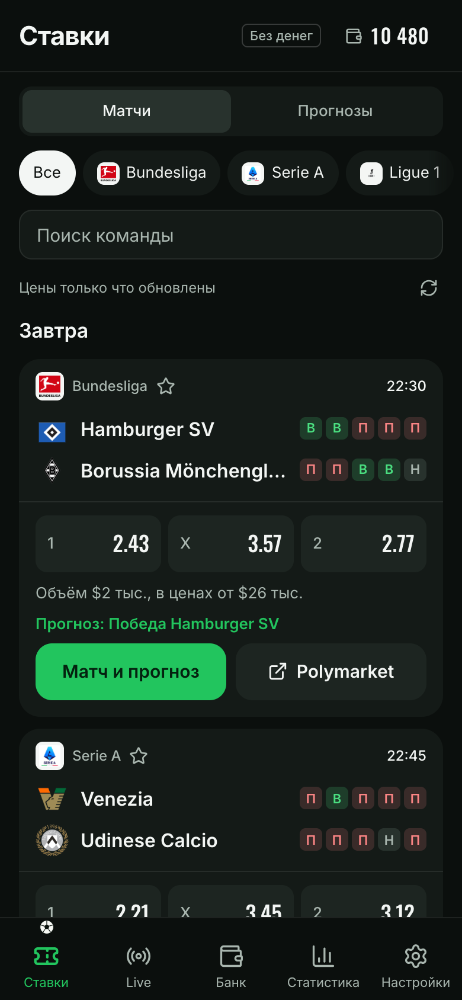
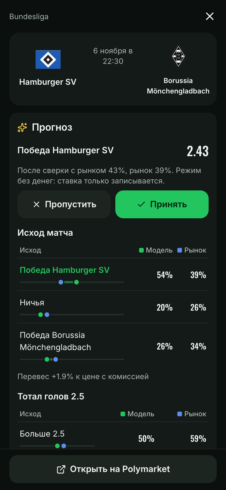
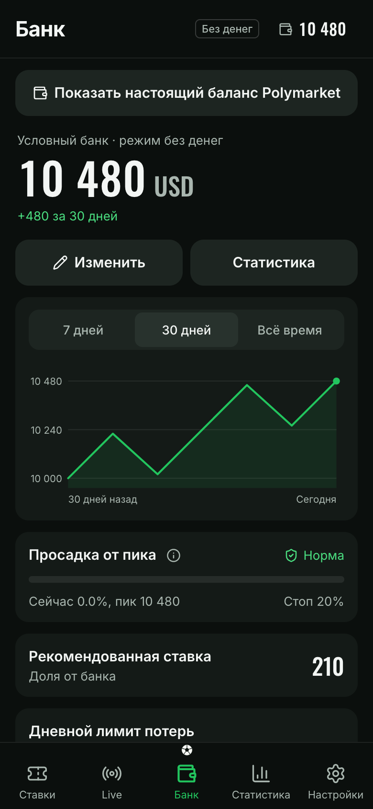
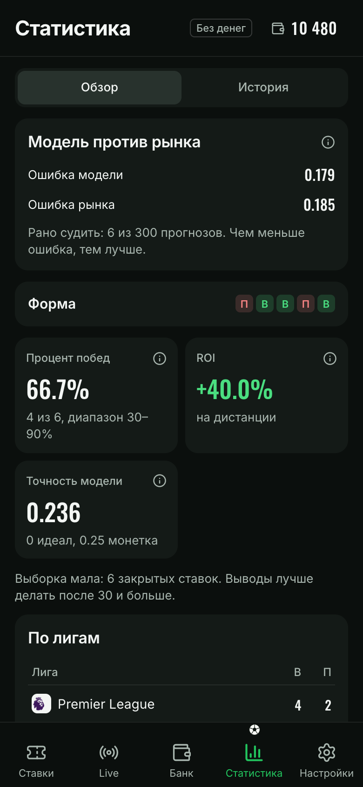

<p align="center">
  
</p>

<h1 align="center">shadowscout</h1>

<p align="center">
  Telegram-бот и Mini App для футбольных ставок: честный прогноз LLM,<br/>
  сверка с ценой рынка и проверка на истории, прав ли был прогноз.
</p>

<p align="center">
  
  
  
  
  
</p>

---

shadowscout не ставит за вас. Модель не видит цену и не может согласиться со ставкой:
она возвращает только вероятности и факты с источниками, а решение принимает код.
Если прогноз не обходит рынок, ставки нет, и так задумано.

Каждый прогноз сохраняется и сверяется с рынком и итогом матча, поэтому CLV и калибровка
показывают, находит ли модель преимущество или ей просто везёт.

## Содержание

- [Бот](#бот)
- [Как рождается прогноз](#как-рождается-прогноз)
- [Mini App](#mini-app)
- [Защитные механизмы](#защитные-механизмы)
- [Архитектура](#архитектура)
- [Быстрый старт](#быстрый-старт)
- [Конфигурация](#конфигурация)
- [Проверки](#проверки)
- [Дисклеймер](#дисклеймер)

## Бот

| Команда | Что делает |
|---|---|
| `/match Команда А - Команда Б` | Разбор одного матча |
| `/league Ла Лига` | Все ближайшие матчи лиги, показывает только те, где есть ставка |
| `/digest Ла Лига, АПЛ` | Тот же разбор автоматически по расписанию |
| `/bankroll 10000` | Банк и размер ставки со стоп-лоссом по просадке |
| `/settle <id> win\|loss` | Зафиксировать исход вручную |
| `/stats` | Винрейт с доверительным интервалом, ROI, CLV, Brier, log-loss |

Фоновые задачи: закрывающая линия для CLV, движение линии, расчёт исходов, новости перед
матчем, дайджест и уведомления о начале матча, голах и финале по вашим ставкам.

## Как рождается прогноз

| Шаг | Что происходит | Кто решает |
|---|---|---|
| 1. Данные | Форма и личные встречи (ESPN), xG (StrikerAPI), новости (RSS), необязательные платные источники | код |
| 2. Оценка | Модель получает данные без цены и порогов и возвращает вероятности и факты | LLM |
| 3. Факты | Факты без источника и даты отбрасываются, меньше двух настоящих значит нет прогноза | код |
| 4. Калибровка | Platt-калибровка по истории, когда её достаточно | код |
| 5. Сверка | Оценка смешивается с рынком (25% модель), разрыв больше 20 пунктов блокирует ставку | код |
| 6. Цена | Преимущество считается против реальной цены с комиссией, порог 1 пункт | код |
| 7. Учёт | Каждый прогноз сохраняется и оценивается против рынка | код |

Пороги `MODEL_WEIGHT`, `MIN_EDGE` и `MAX_GAP` в [`analysis.py`](shadowscout/forecast/analysis.py)
выбраны вручную и пока не подтверждены историей. Вывод о качестве модели делается после
300 оценённых прогнозов. Сломанный ответ модели считается ошибкой, а не тихим пропуском.

## Mini App

Открывается из Telegram кнопкой меню бота:

<p align="center">
  
  
  
  
</p>

<p align="center"><sub>Матчи и цены настоящие. Банк, статистика и прогноз на скриншотах из тестовой базы и тестовой модели.</sub></p>

- **Ставки**: матчи и цены Polymarket, поиск, избранное, прогноз по лиге
- **Live**: идущие матчи и счёт от ESPN
- **Банк**: кошелёк Polymarket (только чтение по публичному адресу), ставки без денег, лимиты и пауза
- **Статистика**: результаты, CLV, калибровка, оценка модели против рынка
- **Настройки**: ключи и модель, уведомления, проверка на истории

Экран матча показывает ход игры, график цены и прогноз. Ключи и модель вставляются прямо
в приложении и хранятся зашифрованными. Визуальный язык описан в [`DESIGN.md`](DESIGN.md).

## Защитные механизмы

- **Слепая оценка**: модель не видит цену, порог и чужое мнение о ставке
- **Стоп-лосс**: новые ставки останавливаются при заданной просадке от пика (по умолчанию 20%)
- **CLV-гейт**: устойчиво отрицательный средний CLV тоже останавливает новые ставки
- **Лимиты и пауза**: задаются в приложении и лежат рядом с деньгами
- **Ставки без денег**: сначала модель проверяется без риска, расчёт идёт по счёту ESPN
- **Решение за человеком**: пароли букмекеров не хранятся, автоматических ставок нет,
  кошелёк только читается, seed-фраза и приватный ключ не нужны и не принимаются

## Архитектура

```
miniapp/ (Next.js)  ──HTTP──▶  shadowscout/api/ (FastAPI, проверка initData)
                                      │
bot (Telegram, фоновые задачи)        │
        │                             │
        └──────────┬──────────────────┘
                   ▼
   shadowscout/forecast/  прогноз, калибровка, модели голов, проверка на истории
   shadowscout/feeds/     ESPN, Polymarket, новости, футбольные API, кэфы
   storage.py             SQLite, один файл на бота и API
   connections.py         ключи и выбранная модель, общие для обоих процессов
```

Бот и API работают отдельными процессами над одним файлом SQLite. Живые данные матчей
и цен Mini App получает через свои маршруты `/feed/*`.

```
shadowscout/
  bot.py  config.py  storage.py  connections.py  wallet.py  match_alerts.py  browser_session.py
  api/       main.py auth.py
  feeds/     espn_data polymarket news_feed football_data odds bookmakers
  forecast/  analysis calibration llm_providers poisson_model xg_model backtest
tests/       тесты бэкенда
miniapp/src/
  app/       layout, страница, стили, маршруты /feed/*
  features/  экраны: app-shell matches match forecast wallet moments bank stats settings onboarding
  ui/        общие элементы и токены анимации
  lib/       клиент API, типы, подписи, источники данных
  store/     состояние приложения
  hooks/     запросы к API
extension/   расширение для страницы букмекера, см. его README
```

## Быстрый старт

```bash
git clone https://github.com/deuteriumZzz/shadowscout.git
cd shadowscout
python3 -m venv .venv && source .venv/bin/activate
pip install -r requirements.txt
cp .env.example .env   # TELEGRAM_BOT_TOKEN, OWNER_TELEGRAM_ID, MINIAPP_ORIGIN, MINIAPP_URL
```

Бот и API запускаются из корня проекта, каждый своей командой:

```bash
python3 -m shadowscout.bot
```

```bash
uvicorn shadowscout.api.main:app --host 0.0.0.0 --port 8000
```

Фронтенд:

```bash
cd miniapp && npm install
```

```bash
echo "NEXT_PUBLIC_API_BASE_URL=https://ваш-api-хост" > .env.local
```

```bash
npm run dev
```

## Конфигурация

В `.env` остаётся только то, что нужно до входа в приложение, полный список в
[`.env.example`](.env.example):

| Переменная | Что делает |
|---|---|
| `TELEGRAM_BOT_TOKEN` | Токен бота от @BotFather |
| `OWNER_TELEGRAM_ID` | Единственный Telegram id, который примет API |
| `MINIAPP_ORIGIN` / `MINIAPP_URL` | CORS-origin и публичный адрес фронтенда |

Ключи LLM и футбольных API вставляются в **Настройках** приложения. Ключ шифрования
создаётся сам при первом сохранении и лежит рядом с базой в файле `<база>.secret`.
ESPN, Polymarket и новости работают без ключей.

## Проверки

```bash
python3 -m pytest -q
```

```bash
cd miniapp && npm run check && npx tsc --noEmit && npx eslint src
```

## Дисклеймер

shadowscout выдаёт статистические оценки, а не финансовый совет, и никогда не трогает
деньги. Ставки на спорт несут реальный финансовый риск независимо от того, какое
преимущество находит модель. Принимайте решения на свой риск и убедитесь, что ставки
легальны в вашей юрисдикции.
